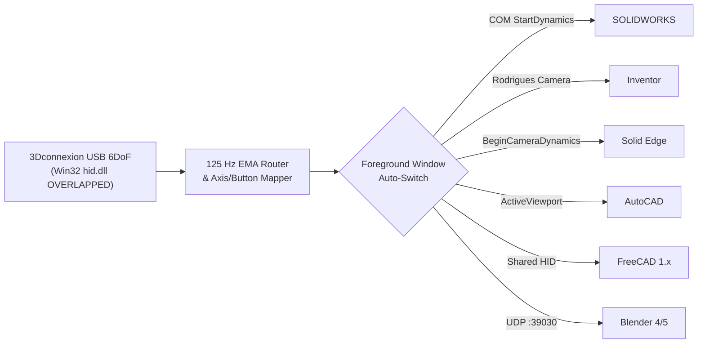

# TecnoSpace3D — Zero-Driver Multi-CAD 6DoF Bridge for Legacy 3D Mice

[](https://github.com/LeonardoNardiko/TecnoSpace3D/actions/workflows/ci.yml)
[](https://github.com/LeonardoNardiko/TecnoSpace3D/releases)
[](LICENSE)
[](#requirements)
[](https://tecnopro.me)

**TecnoSpace3D** breathes new life into discontinued **3Dconnexion SpaceBall 5000 USB** (and classic 6-DoF USB controllers) on **Windows 10 & Windows 11** across modern engineering CAD suites — **without installing legacy drivers** (`3DxSoftware v3.7.22`) and bypassing modern `3DxWare 10` hardware blocks.

> **[Português (PT-BR) abaixo](#-tecnospace3d--ponte-multi-cad-6dof-sem-driver-para-mouses-3d-legados)**

---

## Why TecnoSpace3D?

Modern versions of `3DxWare 10` dropped hardware support for classic USB controllers such as the **SpaceBall 5000 USB (`VID_046D & PID_C621`)**, while modern CAD suites (like **SOLIDWORKS 2024–2026**) will not load legacy 32-bit plugins or standalone `TDxInput` COM servers without proprietary driver checks.

**TecnoSpace3D** solves this cleanly in a single **~72 KB standalone x64 executable**:
1. **Direct Win32 HID (`hid.dll` + `OVERLAPPED` I/O):** Reads 6-axis translation/rotation reports and all 12 physical buttons directly from Windows HID without requiring Administrator privileges or kernel drivers.
2. **125 Hz High-Resolution Router (`timeBeginPeriod(1)` + EMA Smoothing):** Interpolates alternating 62.5 Hz optical HID packets into smooth viewport motion while consuming ~0% CPU/GDI when idle in the system tray.
3. **Automatic Foreground Multi-CAD Switching:** Detects the active CAD window in real time and drives its native viewport camera API without hijacking your regular mouse cursor.



---

## Supported CAD / 3D Environments

| Application | Integration Method | Capabilities |
| :--- | :--- | :--- |
| **SOLIDWORKS** (2020–2026+) | `ISldWorks` / `IModelView` (`StartDynamics`) | 6-DoF Orbit, Roll, Pan, Zoom + 2D Drawing auto-lock + 12 buttons |
| **Autodesk Inventor** (2020–2026+) | `Camera` (`ApplyWithoutTransition` + `SetExtents`) | Full 6-DoF Rodrigues camera math + 2D Drawing Pan/Zoom + buttons |
| **Siemens Solid Edge** (2020–2026+) | `View` (`BeginCameraDynamics` + `GetCamera/SetCamera`) | 6-DoF 3D viewport + 2D Draft `SheetWindow` Pan + standard views |
| **Autodesk AutoCAD** (2020–2026+) | `IAcadApplication` (`ZoomCenter` + `ActiveViewport`) | Instant commandless 2D/3D Pan & Zoom + 3D View direction orbit |
| **FreeCAD** (1.0 / 1.1+) | Shared-access native HID pass-through | Non-blocking `FILE_SHARE_READ/WRITE` coexistence with FreeCAD HID |
| **Blender** (4.x / 5.x) | Localhost UDP (`127.0.0.1:39030`) startup script | Real-time `RegionView3D` quaternion 6-DoF navigation |

### Supported Hardware IDs
* **3Dconnexion SpaceBall 5000 USB** (`046D:C621`, `046D:C622`)
* Classic 3Dconnexion USB HID 6-DoF family (`046D:C623` SpaceTraveler, `046D:C625` SpacePilot, `046D:C626` SpaceNavigator, `046D:C627` SpaceExplorer, and `256F:C6xx` devices using the standard 7-byte HID report layout).

---

## Features
* **Bilingual Instant UI (`EN-US` / `PT-BR`):** Hot-switch language directly in the header or System Tray menu.
* **Live 6-Axis Telemetry & Per-Axis Inversion:** Real-time bars for `TX, TY, TZ, RX, RY, RZ`, individual `Inv` toggles, `Swap Y <-> Z`, **Dominant Axis Mode** (single-axis precision), and **3D Rotation Lock** for sketching.
* **12 Programmable Buttons (`1..9, A, B, C`):** Map to *Zoom to Fit*, *Normal To*, *Isometric*, *Front/Top/Right/Back/Left/Bottom*, *Measure*, *Undo*, *Rebuild*, *Escape*, *Zero Sensor*, or *Speed +/-*.
* **Zero External Dependencies:** Compiles with the built-in Windows .NET Framework 4.x x64 compiler (`csc.exe`) using embedded COM interop types (`/link:`). Settings are stored locally in `%APPDATA%\TecnoSpace3D\config.json`.

---

## Quick Start

### Option 1: Download Pre-built Release
1. Download `TecnoSpace3D.exe` from **[Releases](../../releases)**.
2. Plug in your SpaceBall 5000 USB and run `TecnoSpace3D.exe`.
3. *(Optional for Blender)* Copy [`integrations/blender/tecnospace3d_startup.py`](integrations/blender/tecnospace3d_startup.py) into `%APPDATA%\Blender Foundation\Blender\<version>\scripts\startup\`.
4. Close the window (`X`) to minimize it to the Windows System Tray with zero GDI overhead.

### Option 2: Build from Source
No Visual Studio installation required — uses the native Windows `.NET Framework x64` compiler and auto-detects whichever CAD suites are installed on your PC:

```powershell
git clone https://github.com/LeonardoNardiko/TecnoSpace3D.git
cd TecnoSpace3D
powershell -ExecutionPolicy Bypass -File .\build.ps1
```
Output binary: `.\bin\TecnoSpace3D.exe`.

---

## 🇧🇷 TecnoSpace3D — Ponte Multi-CAD 6DoF Sem Driver para Mouses 3D Legados

O **TecnoSpace3D** permite utilizar o clássico **3Dconnexion SpaceBall 5000 USB (`046D:C621`)** e outros controladores 6DoF legados no **Windows 10 e Windows 11** nos principais softwares de engenharia atuais (**SOLIDWORKS**, **Autodesk Inventor**, **Siemens Solid Edge**, **AutoCAD**, **FreeCAD** e **Blender**), sem precisar instalar drivers antigos de 32 bits (`v3.7.22`) e sem sequestrar o ponteiro do seu mouse principal.

### Principais Recursos
* **Leitura HID Nativa (`hid.dll`):** Opera em espaço de usuário sem exigir privilégios de Administrador.
* **Motor 125 Hz + Filtro Exponencial (EMA):** Movimento fluido com `StartDynamics` / `ApplyWithoutTransition` / `BeginCameraDynamics` e `0%` de uso gráfico quando recolhido na bandeja do relógio.
* **Auto-Switch Inteligente:** Detecta automaticamente qual janela CAD está ativa em primeiro plano e alterna o protocolo de câmera em tempo real.
* **12 Botões Programáveis + Interface Bilíngue (`PT-BR` / `EN-US`):** Configuração salva em `%APPDATA%\TecnoSpace3D\config.json`.

### Como Compilar
```powershell
powershell -ExecutionPolicy Bypass -File .\build.ps1
```

---

## License
Released under the [MIT License](LICENSE).
